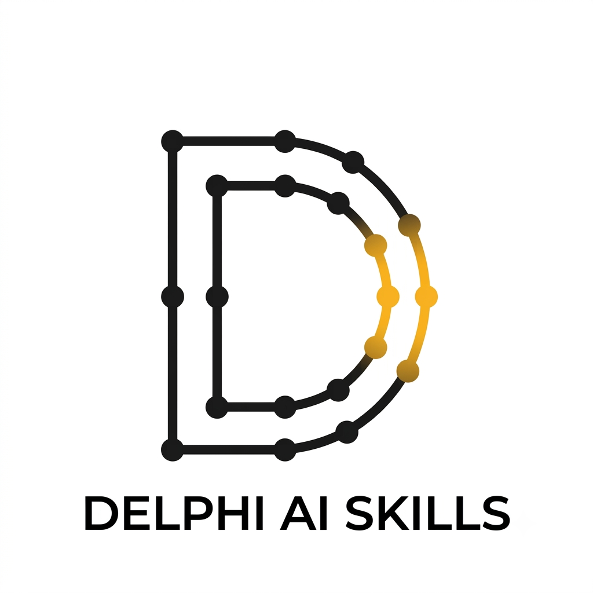

<p align="center">
  
</p>

<p align="center">
  AI coding-agent <strong>skills</strong> for <strong>Delphi</strong> —
  the language and the RTL, plus
  <a href="https://github.com/danieleteti/delphimvcframework">DelphiMVCFramework</a>.
</p>

<p align="center">
  
  
  
  
</p>

A *skill* is a Markdown file your AI agent loads **on demand**, when your request matches it. It teaches the
agent the **real** API — exact unit names, signatures, attributes, ownership rules, idioms — so it stops
inventing plausible-but-wrong Delphi. Every identifier was copied from the shipped RTL/VCL source and the
DelphiMVCFramework sources and samples, never written from memory, and [`check.py`](docs/versioning.md) re-verifies
them on every change.

- **Any Delphi developer:** `delphi` (the language and the RTL) and `delphi-code-smells` (reviewing code, hunting
  leaks) apply to any `.pas` file, with no framework and no particular project layout.
- **DelphiMVCFramework servers:** seven more skills cover REST controllers, Minimal API, TemplatePro web apps,
  JSON-RPC, security and testing.

Works with Claude Code, Codex, Cursor, Gemini CLI, Windsurf, Continue and anything else that reads Markdown.
Articles about the project: [danieleteti.it/tags/delphi-ai-skills](https://www.danieleteti.it/tags/delphi-ai-skills/).

## Quick start

```bat
git clone https://github.com/danieleteti/delphi-ai-skills.git
cd delphi-ai-skills
install_in_claude.bat
```

That is all for Claude Code, which finds the skills on its own. Other agents: [installing](docs/installing.md).
Then start the agent in any Delphi project and ask:

> *Why does this unit leak? Fix it.*

**Building a DMVCFramework server?** The DMVC skills add features to a wizard-generated project; they do not
scaffold one. In the IDE: **File → New → Other → Delphi Projects → DelphiMVCFramework → New DMVCFramework
Application**. Pick a preset, compile and run it once, then start the agent **inside the project folder**:

> *Add a Customers controller with full CRUD, backed by an ActiveRecord entity on table `customers`*

## The skills

| Skill | What it covers | Use it to |
|-------|----------------|-----------|
| **`delphi`** | Version gating (11 vs 12 vs 13), memory and lifetime, strings, exceptions, generics, RTTI, threading | Write or review any Delphi code |
| **`delphi-code-smells`** | Compiler warnings that mean a bug, leak detection, a catalogue of smells | Review code, hunt a leak or an AV |
| **`dmvcframework`** | Engine, controllers, routing, `IMVCResponse`, ActiveRecord, DI, validation, middleware, JWT, SSE, dotEnv | Build a REST API or any server feature |
| **`dmvcframework-minimal-api`** | Lambda routes, route groups, parameter binding, endpoint filters, `.AsWeb` | Write routes without controller classes |
| **`dmvcframework-webapp`** | TemplatePro views, fragments, `ViewData` ownership, cookie/JWT login, HTMX helpers | Render HTML pages and fragments |
| **`dmvcframework-ui`** | Bootstrap 5.3, `baselayout.html`, `style.css` tokens, dark mode, toasts | Style the web app the wizard generates |
| **`dmvcframework-security`** | Access control, mass assignment, SQL injection, XSS, CSRF, uploads, SSRF, JWT hardening | Any endpoint that takes client input (loaded automatically) |
| **`dmvcframework-jsonrpc`** | JSON-RPC 2.0 services, request vs notification, error codes, `IMVCJSONRPCExecutor` client | Expose or consume JSON-RPC |
| **`dmvcframework-testing`** | In-process `IMVCServer` + `IMVCRESTClient` + DUnitX, auth and database test patterns | Test a DMVCFramework API |
| **`htmx-skill`** | Index of the htmx 2.x reference pages (release 2.0.11) | Ask about any htmx attribute, event or header |

They are complementary: the Minimal API, web-app and JSON-RPC skills build on the core one and all of them on
`delphi`. **Install them all** — the agent picks the right ones. Example prompts for each skill, and how to force
one: [prompts](docs/prompts.md).

### Two things the DMVCFramework skills insist on

Both are about *server* projects; the two Delphi skills have no such rules.

**1. Start from a wizard project.** They detect the wizard layout (`EngineConfigU.pas`, `RoutesU.pas`,
`bin/.env`, …) and add features inside it. If there is no project, they stop and tell you to create one rather
than inventing a half-correct bootstrap.

**2. The server backend is Indy Direct.** For a *new* project: a self-contained executable, no WebModule, no
WebBroker. An **existing WebBroker project — ISAPI under IIS, an Apache module — is fully supported**: the
skills detect the host, keep it, and never suggest migrating. Everything above the host is identical on every
backend.

## Why these skills exist

Ask an agent for a DelphiMVCFramework Minimal API without them and you get confident, well-shaped,
**uncompilable** code: `MapGroup` instead of `Prefix`, `OkResponse` instead of `Ok`, middleware classes that do
not exist, a `ToFree` around the returned object that frees it twice. The names are plausible: they are what the
framework *would* be called if it were ASP.NET.

Each skill was built by running that failure first, documenting the API the framework really has, then
re-running the same task to confirm the agent gets it right. A ten-second test of any agent:

> *In a DMVCFramework functional action, do I need `ToFree` on the object I return?*

The right answer is **no: the framework frees the returned object, and `ToFree` would free it twice**.

## Versions

| | |
|---|---|
| **Skills version** | **0.3.0** (pre-1.0: the shape of the set may still change) |
| **Targets DelphiMVCFramework** | **3.5.x** (`silicon`), branch `dmvc-3.5` |
| **Verified against** | Delphi 13 Florence's RTL (targeting 11 Alexandria and later) and DelphiMVCFramework 3.5.0 |

**One branch per framework line.** The skills follow DelphiMVCFramework's *major.minor*: the same skills serve
3.5.0 and 3.5.1, never 3.6.0. Each line has its own branch (`dmvc-3.5`, then `dmvc-3.6`), created from `main`
when that release ships and afterwards receiving corrections only. `main` is the line in development. To stay
on your line, install from its branch:

```batch
git clone -b dmvc-3.5 https://github.com/danieleteti/delphi-ai-skills.git
```

Early release: expect rough edges, and please report them. More: [versioning and checking](docs/versioning.md),
[changelog](docs/changelog.md), [repository layout](docs/layout.md).

## Contributing

Found an API the skills get wrong, or a pattern they are missing? Open an issue or a PR. One rule: every claim
must be verifiable against the DelphiMVCFramework source or a sample project — cite the file. No API names from
memory.

## Credits

The secure-coding skill adapts the topic coverage of [VibeSec](https://github.com/BehiSecc/VibeSec-Skill)
(Apache-2.0) to DelphiMVCFramework — every control is rewritten against the framework's real API.

## License

Apache License 2.0 — see [LICENSE](LICENSE).
